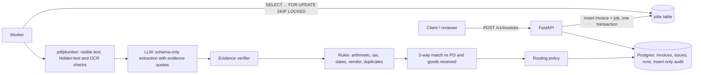

# LedgerLens

LedgerLens turns vendor invoice PDFs into validated, 3-way-matched records and sends only the
exceptions to a human reviewer.

> **Portfolio project, synthetic data.** The customer ("Northwind Supplies", an AP team at a
> distributor) is simulated, and so are all 150 invoices. Real-world accuracy will differ.

Status: **v0.1.0, built and tested locally.** It has not been deployed yet, and it has not yet been
evaluated with a real model (see [Status](#status)).

## How it works



**The LLM proposes, code decides.** The model's only job is to fill a schema. Each value must come
with a verbatim quote from the PDF text. If the quote isn't found, that field's confidence drops to
0 and the invoice goes to review. Arithmetic, tax, duplicate detection, the PO/GRN (goods received
note) match and the approval decision are all plain, tested Python. This is a deterministic state
machine with one LLM step, not an agent ([ADR-003](docs/adr/0003-deterministic-routing-not-an-agent.md)).

An invoice is **auto-approved only if every one of these holds**: no warning or error issues, every
required field has confidence ≥ 0.8 with verified evidence, the vendor is known, the PO is found
and matches (price within +2%, quantity ≤ received), and the total is ≤ the per-currency cap
(USD 5,000). Anything else goes to `needs_review` with machine-readable reasons. An unknown
vendor with no PO is `rejected`.

## Results

### Routing on ground truth (oracle extraction): measured

This isolates the deterministic half: what the rules and routing do if extraction were perfect.
The oracle is not a model, and these numbers are not model accuracy.

| dev split (100 invoices) | Result |
|---|---|
| **False auto-approvals** (hard gate: 0) | **0** |
| Injected anomalies caught | 28 / 28 (all 11 types) |
| Clean invoices flagged by mistake | 0 |
| Route accuracy vs labels | 100 / 100 |

Reproduce it (no model, no cost) with `uv run python -m ledgerlens.evals routing --split dev`. A
perfect score here is expected: the same author wrote the generator and the rules. It shows the
rules are wired correctly, not that the system works on real invoices.

### With a real model: not measured yet

Field accuracy, line-item F1, valid-output rate, cost per invoice and p50/p95 latency come from
`python -m ledgerlens.evals system --split dev` once a provider is configured. The held-out
`test` split has not been evaluated (see [evals/HELDOUT_LOG.md](evals/HELDOUT_LOG.md)).

## Run it locally (Windows PowerShell; `make` targets on Linux/macOS)

```powershell
uv sync
Copy-Item .env.example .env
docker compose up -d --wait db           # Postgres + pgvector on 127.0.0.1:5434
uv run alembic upgrade head
.\tasks.ps1 seed                         # vendors, POs, goods receipts
.\tasks.ps1 check                        # ruff + mypy --strict + all tests
.\tasks.ps1 key -Name me -Role clerk     # prints an API key once
.\tasks.ps1 run                          # http://127.0.0.1:8000/docs
```

Full stack: `docker compose up -d --build` runs migrations and the seed, then serves the API at
http://127.0.0.1:8002/docs and Jaeger at http://127.0.0.1:16687.

With `LLM_PROVIDER=fake` (the default) the pipeline runs with zero spend. Every invoice then
lands in review as `EXTRACTION_INVALID` or `NEEDS_OCR`. That is the fail-safe path, not a bug. Set
`LLM_PROVIDER=openai_compat`, `LLM_BASE_URL`, `LLM_MODEL` and `LLM_API_KEY`, and add the model's
prices to `config/pricing.yaml`, for real extraction.

## API

| Method & path | Purpose | Role |
|---|---|---|
| `POST /v1/invoices` (multipart `file`) | Upload a PDF → `202 {invoice_id, job_id, status}`; same file → same invoice | clerk+ |
| `GET /v1/invoices/{id}` | Invoice, lines, reasons, extraction cost/latency, decisions, audit history | clerk+ |
| `GET /v1/review-queue?status=needs_review&limit=&after=` | Exceptions with reasons (keyset pagination) | clerk+ |
| `POST /v1/invoices/{id}/decision` | `approve` / `reject` / `correct` / `reopen` with a reason | clerk ≤ limit, approver any |
| `GET /v1/jobs/{id}` | Job state, attempts, last error | clerk+ |
| `POST /v1/admin/jobs/{id}/requeue` | Retry a dead-lettered job | admin |
| `GET /healthz`, `/readyz`, `/metrics` | Liveness, DB readiness, Prometheus (admin) | — |

All errors are RFC 9457 `application/problem+json`. For example, a clerk deciding above their
limit gets `403 decision-limit` with "Role 'clerk' may decide invoices up to 5000.00 USD".

## Data

`uv run python -m ledgerlens.data.generator --seed 42` writes `evals/datasets/invoices/`:

- **The invoices:** 150 PDFs in 10 layouts, with ground-truth JSON, 20 vendors, 138 POs and goods
  receipts.
- **Injected anomalies:** ~20% of regular invoices carry one of line-sum, tax, duplicate, unknown
  vendor, missing PO, price above tolerance, quantity above received, or future date.
- **Adversarial fixtures:** 5 (visible prompt injection ×3, hidden white text, absurd total), plus
  3 image-only scans.
- **Split:** 100 dev / 50 held-out test, stratified by anomaly type. Frozen by SHA-256 in
  `SHA256SUMS`; each PDF's hash is in its ground truth.
- **Reproducible:** the same seed gives byte-identical output, and a test enforces it.

Counts per label: [ANOMALIES.md](evals/datasets/invoices/ANOMALIES.md).

## Verified locally (15 Nov 2026)

| Check | Result |
|---|---|
| `ruff`, `ruff format --check`, `mypy --strict src` | clean |
| Tests (unit + integration on real Postgres) | 216 passed |
| Decision-table cases (match + routing, incl. exact tolerance boundaries) | 24 |
| Duplicate upload | same `invoice_id`, one row, one job |
| Worker killed mid-job (stale lock) | reaped, processed once, one `auto_approved` audit event |
| Provider down (3 timeouts) | job dead-lettered, invoice `failed`; admin requeue then succeeds |
| UPDATE / DELETE on `audit_events` | rejected by trigger |
| Docker stack: upload → worker → review | works; no API key or invoice text in logs |

## Limitations and next steps

- Synthetic data only. The next step is a few public sample invoices with clear licences,
  labelled by hand.
- No OCR: scans route to review (`NEEDS_OCR`). Tesseract is a stretch goal.
- Corrections update the stored fields but don't re-run the rules. The reviewer still has to
  approve explicitly.
- The upload rate limit is per process. With several replicas it needs a shared counter.
- File bytes are stored in Postgres for the demo. A real deployment would use S3-compatible storage.
- No ERP write-back and no payments (non-goals).

More: [threat model](docs/THREAT_MODEL.md) ·
[ADR-002 Postgres queue](docs/adr/0002-postgres-as-the-job-queue.md) ·
[ADR-003 not an agent](docs/adr/0003-deterministic-routing-not-an-agent.md)

## Status

Built here (manual Days 8–15, code side): generator, extraction with evidence and repair, rules,
3-way match, routing, async pipeline, review API, audit trail, security tests, eval harness.

Still to do:

- **Day 9/10:** choose an LLM provider, run `evals system` on dev, categorise errors, write prompt v2.
- **Day 15:** one held-out run.
- **Day 16:** deploy (Render + Neon), load test, `docs/COSTS.md`.
- **Day 17:** demo video and customer deck.
- **Day 7:** discovery and requirements docs.
