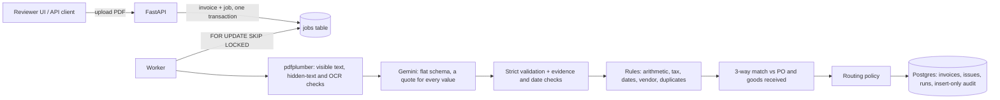

# LedgerLens

**Live demo:** https://ledgerlens-wjry.onrender.com (free hosting: the first visit after idling can take about a minute to wake up). Demo access key on request.


LedgerLens turns vendor invoice PDFs into validated, 3-way-matched records and sends only the
exceptions to a human reviewer.

> **Portfolio project, synthetic data.** The customer ("Northwind Supplies", an AP team at a
> distributor) is simulated, and so are all 150 invoices. Real-world accuracy will differ.

**Status: v1.0.0.** Built, tested and evaluated with a real model (Gemini), with one held-out
run. Not yet deployed; the deployment config is ready ([Deployment](#deployment)).

## Results

Model `gemini-3.1-flash-lite`, prompt `extract_v2`. Numbers come from the linked report files.

| | dev (100 invoices) | **held-out test (50, run once)** |
|---|---|---|
| **False auto-approvals** (hard gate: 0) | **0** | **0** |
| Planted anomalies caught | 28 / 28 | 11 / 11 |
| Clean invoices flagged by mistake | 0 | 0 |
| Valid structured output, first try | 100% | 100% |
| Header field accuracy (all 10 fields) | 100% | 100% |
| Line-item F1 | 1.00 | 1.00 |
| Clean invoices auto-approved (under the cap) | 94.1% | 92.1% |
| Cost per invoice (mean) | $0.00196 | $0.00190 |
| Latency per invoice, p50 / p95 | 3.4 s / 16.2 s | 3.4 s / 34.7 s |

Reports: [dev v2](evals/reports/ledgerlens-system-dev-20261115-064350-0178182-dirty.md) ·
[held-out](evals/reports/ledgerlens-system-test-20261115-065241-0178182-dirty.md) ·
[dev v1](evals/reports/ledgerlens-system-dev-20261115-063320-0178182-dirty.md) ·
[held-out log](evals/HELDOUT_LOG.md) · [costs](docs/COSTS.md)

**What the evaluation changed.** The first 20-invoice run had **1 false auto-approval**. The model
read a day-first date, `04/12/2026`, as 12 April. The quote was really on the page, so the evidence
check passed, but the reading was wrong, and a future-dated invoice looked like a past one. All 6
date errors on dev were the same kind of misread. Two fixes followed:
1. **A deterministic date-evidence rule:** the extracted date must match what its quote means. If
   the day/month order can't be settled from the invoice, it goes to review as `AMBIGUOUS_DATE`.
2. **Prompt v2,** which tells the model how to work out the order.

The rule is the safety net and the prompt reduces how often it's needed. v2 took date accuracy
from 0.96 to 1.00. The cost is that 6–8% of clean invoices go to review because of ambiguous
dates. That's a stated trade-off, not a bug.

The low p95 latency comes from free-tier rate limits and retries; the median is 3.4 s.

## How it works



**The LLM proposes, code decides.** The model has no tools and only fills a schema. Every value
must quote text found in the PDF, or that field drops to confidence 0. Arithmetic, tax, dates,
duplicates, the PO/GRN match and the approval decision are plain, tested Python. This is a
deterministic pipeline with one LLM step, not an agent
([ADR-003](docs/adr/0003-deterministic-routing-not-an-agent.md)).

An invoice is **auto-approved only if all of these hold**:
- no warning or error issues;
- every required field has confidence ≥ 0.8, with verified evidence;
- the vendor is known and the PO is found;
- every line matches the PO: price within +2%, quantity no more than received;
- the total is ≤ the per-currency cap (USD 5,000).

Anything else goes to `needs_review` with machine-readable reasons. An unknown vendor with no PO
is `rejected`.

## Reviewer UI

`/ui` is a set of server-rendered pages (Jinja2 + HTMX, no frontend build). Reviewers sign in with
a clerk-or-higher API key, kept in an HttpOnly, SameSite=Strict cookie. The pages give you:
- the review queue by status, with each invoice's reasons;
- upload;
- an invoice detail page that updates live while the worker runs, and shows reasons, lines,
  extraction cost and audit history;
- approve, reject, correct and reopen.

The UI calls the same service layer as the API, so the role and amount limits are identical.

## Run it locally (Windows PowerShell; `make` targets on Linux/macOS)

```powershell
uv sync
Copy-Item .env.example .env              # then set LLM_* for a real model (see docs/COSTS.md)
docker compose up -d --wait db           # Postgres + pgvector on 127.0.0.1:5434
uv run alembic upgrade head
.\tasks.ps1 seed                         # vendors, POs, goods receipts
.\tasks.ps1 check                        # ruff + mypy --strict + all tests
.\tasks.ps1 key -Name me -Role approver  # prints an API key once
.\tasks.ps1 run                          # http://127.0.0.1:8000/ui
```

Full stack: `docker compose up -d --build` runs migrations and the seed, then serves
http://127.0.0.1:8002/ui, API docs at `/docs`, and Jaeger at http://127.0.0.1:16687.
With `LLM_PROVIDER=fake`, every invoice goes to review (`EXTRACTION_INVALID`). That's the
fail-safe path, at zero spend.

Evaluate:

| What | Command |
|---|---|
| Rules on ground truth (no model, no cost) | `uv run python -m ledgerlens.evals routing --split dev` |
| The whole system on dev | `uv run python -m ledgerlens.evals system --split dev --max-cost 1.00` |
| Held-out (once per project, logged) | `uv run python -m ledgerlens.evals system --split test` |

## API

| Method & path | Purpose | Role |
|---|---|---|
| `POST /v1/invoices` (multipart `file`) | Upload → `202 {invoice_id, job_id, status}`; same file → same invoice | clerk+ |
| `GET /v1/invoices/{id}` | Invoice, lines, reasons, extraction cost/latency, decisions, audit history | clerk+ |
| `GET /v1/review-queue?status=&limit=&after=` | Exceptions with reasons (keyset pagination) | clerk+ |
| `POST /v1/invoices/{id}/decision` | `approve` / `reject` / `correct` / `reopen` + reason | clerk ≤ limit, approver any |
| `GET /v1/jobs/{id}` · `POST /v1/admin/jobs/{id}/requeue` | Job state · retry a dead-lettered job | clerk+ · admin |
| `GET /healthz`, `/readyz`, `/metrics` | Liveness, DB readiness, Prometheus (admin) | — |

All errors are RFC 9457 `application/problem+json`.

## Data

`uv run python -m ledgerlens.data.generator --seed 42` writes `evals/datasets/invoices/`:

- **The invoices:** 150 PDFs in 10 layouts, with ground-truth JSON, 20 vendors, 138 POs and goods
  receipts.
- **Injected anomalies:** about 20% of regular invoices carry one. There are also 5 adversarial
  fixtures and 3 image-only scans.
- **Split:** 100 dev / 50 held-out, stratified and frozen by SHA-256.
- **Reproducible:** the same seed gives byte-identical output, and a test enforces it.

Label counts: [ANOMALIES.md](evals/datasets/invoices/ANOMALIES.md).

## Engineering checks (15 Nov 2026)

| Check | Result |
|---|---|
| `ruff`, `ruff format --check`, `mypy --strict src` | clean |
| Tests (unit + integration on real Postgres, incl. UI) | 233 passed |
| Decision-table cases (match + routing, exact tolerance boundaries) | 24 |
| Worker killed mid-job / provider down 3× | processed once / dead-lettered, then requeued |
| UPDATE or DELETE on `audit_events` | rejected by trigger |
| Docker image | runs as non-root; no API key or invoice text in logs |
| Load test (fake model, 20 users, 5 min) | see [LOADTEST](#load-test) |

## Load test

Closed loop: 20 users, each uploads an invoice, waits until it's routed (checking every 1 s),
then repeats, for 5 minutes. It used the **fake model**, so it measures LedgerLens's own overhead:
upload, queue, PDF parsing and the database, with one embedded worker on a laptop that was also
running the load client ([raw result](evals/reports/loadtest-fake-20u-300s-poll1s.json)).

| Metric | Result |
|---|---|
| Throughput | **151 invoices/min** (776 in 307 s), 0 errors |
| Upload latency p50 / p95 | 0.18 s / 0.59 s |
| End-to-end p50 / p95 (incl. queue wait, 20 in flight) | 7.8 s / 10.5 s |
| Per-job processing time, p50 / p95 (worker logs, earlier open-loop run) | 0.22 s / 0.52 s |

With the real model, extraction adds about 3.4 s per invoice (median), so one worker handles
roughly 15 invoices/min. Scale out with standalone workers (`python -m ledgerlens.worker`) if
needed.

Lesson from the first attempt: an open-loop run (uploads as fast as possible) built a backlog of
10,000 invoices. A closed-loop run with 0.1 s status checks mostly measured its own polling
pressure: 31/min, because the polling and the worker share one process.

## Deployment

[`render.yaml`](render.yaml) and [docs/DEPLOYMENT.md](docs/DEPLOYMENT.md) cover Render's free web
service plus Neon Postgres. It needs your accounts: about 30 minutes, steps in the doc.

## Limitations and next steps

- Synthetic data only. Next: hand-labelled public sample invoices.
- No OCR. Scans route to review (`NEEDS_OCR`).
- Free-tier Gemini: rate limits inflate p95 latency, and Google may use free-tier content to
  improve its products. Use synthetic data only, or the paid tier.
- Corrections update fields without re-running the rules. An approver still decides.
- The upload rate limit is per process, and file bytes live in Postgres (fine for a demo).
- No ERP write-back or payments (non-goals).

Docs: [requirements](docs/P1-REQUIREMENTS.md) · [threat model](docs/THREAT_MODEL.md) ·
[ADR-001](docs/adr/0001-postgres-for-relational-queue-and-vectors.md) ·
[ADR-002](docs/adr/0002-postgres-as-the-job-queue.md) ·
[ADR-003](docs/adr/0003-deterministic-routing-not-an-agent.md) · [costs](docs/COSTS.md)
